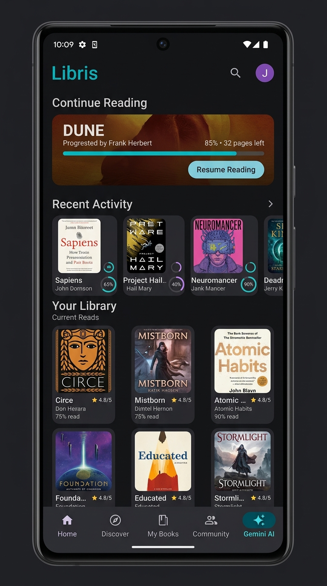
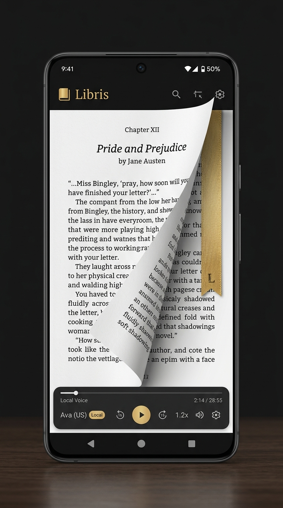

<p align="center">
  
</p>

<p align="center">
  <strong>Lector de libros y PDF con estética de biblioteca personal, narración por voz y un asistente literario opcional.</strong>
</p>

<p align="center">
  
  
  
  
</p>

<p align="center">
  
  
  
</p>

---

## 📖 Qué es Libris

**Libris** (carpeta y repositorio `LIBROUS`) es una app Android de lectura construida con
**Kotlin + Jetpack Compose**. Incluye una biblioteca de demostración, importación de
PDF, lectura con animación de página, temas de lectura, narración con las voces del
sistema y un asistente literario que funciona con Gemini o con respuestas locales.

> **Aviso importante:** este repositorio es una **demo funcional**, no un lector
> listo para producción. Varias pantallas son maquetas: las cuentas de Google y
> Wattpad son simuladas, la sincronización en la nube no existe y la biblioteca
> vive en memoria. Lee [Estado y limitaciones](#-estado-y-limitaciones) antes de
> usarlo o publicarlo.

---

## ✨ Funcionalidades

### 📚 Biblioteca
- Estantería con portadas generadas, progreso, favoritos y filtros por formato.
- Biblioteca de ejemplo con clásicos y una historia original de estilo Wattpad.
- Importación de **PDF** desde el selector del sistema.
- Estadísticas de lectura y acceso rápido a “Continuar leyendo”.
- Diseño adaptativo: barra inferior en teléfono y **NavigationRail** en tablet.

### 📖 Lector
- Renderizado de PDF página a página.
- Animación **Page Curl 3D** y modo deslizamiento.
- Temas **Claro, Oscuro, Sepia y OLED**.
- Tipografías y tamaños de letra configurables.
- Barra de progreso, salto de página y favoritos.

### 🎧 Narrador
- **TextToSpeech** con las voces instaladas en el dispositivo.
- Control de velocidad y tono.
- Reproducción, pausa y detención desde una hoja inferior.
- Sin servicios de voz en la nube.

### 🕘 Historial
- Sesiones de lectura con página alcanzada, porcentaje y duración.
- Acceso directo para continuar un libro.

### 🧭 Explorar
- Pestañas de descubrimiento: Wattpad/Web, clásicos libres y “Google Drive”.
- Las tarjetas de descarga y sincronización son **contenido de demostración**;
  no descargan libros ni conectan con esas plataformas.

### 🤖 Asistente literario
- Chat con Gemini si se configura una clave en `.env`.
- Si no hay clave, responde con recomendaciones locales predefinidas.
- Puede analizar la biblioteca y el historial en el prompt.
- La clave se compila en `BuildConfig`; para producción debería usarse un proxy.

### 👤 Cuentas y ajustes
- Pantalla de “Ajustes” con cuentas de Google/Wattpad **simuladas**.
- Tarjeta de contacto del desarrollador.
- Ajustes de lectura y formato de página.

---

## 📱 Capturas y arte

<p align="center">
  
  &nbsp;&nbsp;
  
</p>

<p align="center">
  <em>Arte promocional del proyecto. No son capturas de un dispositivo real.</em>
</p>

---

## 🚧 Estado y limitaciones

| Área | Estado real |
|------|-------------|
| Biblioteca | En memoria: se reinicia al cerrar el proceso |
| Progreso e historial | No se guardan en disco |
| Cuentas Google/Wattpad | **Simuladas**, sin OAuth ni sesión real |
| Sincronización en la nube | **No implementada**; la pantalla es una maqueta |
| Descargas de Wattpad/Drive | **No implementadas** |
| Gemini | Funciona con clave propia; sin clave usa respuestas locales |
| PDF | Importación y renderizado reales |
| TTS | Voces reales del sistema |
| Tests | Dos pruebas de ejemplo; no cubren la UI ni el lector |
| `applicationId` | `com.aistudio.libris.reader` (heredado de AI Studio) |
| Firma release | Configuración de AI Studio; requiere keystore propio |

### Sobre los textos de ejemplo

La biblioteca incluye fragmentos de obras clásicas y una historia de ejemplo. Los
derechos de los textos originales pertenecen a sus autores y no están cubiertos por
la licencia del código. Si reutilizas el proyecto, sustituye esos textos por
contenido propio o de dominio público verificado en tu país.

---

## 🛠️ Tecnologías

| Capa | Tecnología |
|------|-----------|
| Lenguaje | Kotlin 2.2 |
| UI | Jetpack Compose · Material 3 |
| Build | Gradle 9.3 · AGP 9.1 · KSP |
| PDF | `android.graphics.pdf.PdfRenderer` |
| Voz | `android.speech.tts.TextToSpeech` |
| IA | Gemini REST + OkHttp; respuestas locales de respaldo |
| Imágenes | Coil |
| Tests | JUnit 4 · Robolectric |

No hay base de datos ni inyección de dependencias: la app usa un `BookRepository`
en memoria creado manualmente en `MainActivity`.

---

## 🏗️ Arquitectura

```
MainActivity (composition root manual)
   ├── PdfRendererManager
   ├── NarratorManager
   ├── GeminiBookAdvisorService
   └── BookRepository (StateFlow en memoria)
          │
          ▼
   MainApp (Compose)
      ├── HomeScreen
      ├── HistoryScreen
      ├── ExploreScreen
      ├── GeminiAdvisorScreen
      ├── AccountsSyncScreen
      └── ReaderScreen
```

- **UI:** composables que observan `StateFlow` del repositorio.
- **Datos:** modelos inmutables (`BookItem`, `ReadingHistoryItem`, `ReaderSettings`).
- **Servicios:** PDF, TTS y Gemini encapsulados fuera de la UI.
- **Navegación:** estado local (`AppDestination`) con `Crossfade`; no usa Navigation Compose.

Más detalle en [`docs/ARQUITECTURA.md`](docs/ARQUITECTURA.md).

---

## 🚀 Compilar

### Requisitos

- JDK 17.
- Android Studio reciente o Android SDK con platform 36.
- Gradle wrapper incluido.

### 1. Clonar

```bash
git clone https://github.com/JonathanDevHurtado/LIBROUS.git
cd LIBROUS
```

### 2. Crear el `debug.keystore`

El proyecto heredado de AI Studio firma el build de debug con un keystore en la raíz.
No se versiona. Genéralo una vez:

```bash
keytool -genkeypair -v \
  -keystore debug.keystore \
  -storepass android \
  -alias androiddebugkey \
  -keypass android \
  -dname "CN=Android Debug,O=Android,C=US" \
  -keyalg RSA -keysize 2048 -validity 10000
```

### 3. Gemini (opcional)

```bash
cp .env.example .env
# Edita .env y pon tu clave real
```

Sin `.env` la app compila y el asistente usa respuestas locales. **Nunca subas `.env`.**

### 4. Compilar y probar

```bash
export JAVA_HOME=/ruta/al/jdk-17
./gradlew --no-daemon testDebugUnitTest assembleDebug
```

El APK queda en `app/build/outputs/apk/debug/app-debug.apk`.

### Release

La configuración de release es la de AI Studio: espera un keystore en
`my-upload-key.jks` o en la ruta de `KEYSTORE_PATH`, con `STORE_PASSWORD` y
`KEY_PASSWORD` como variables de entorno. No hay claves en el repositorio.

---

## 🔒 Privacidad y seguridad

- La app declara `INTERNET` porque el asistente puede llamar a Gemini.
- **No hay analytics, publicidad ni telemetría.**
- Las cuentas de Google/Wattpad son datos de demostración; no se autentica ninguna.
- Los PDFs importados y generados se guardan en el almacenamiento local de la app.
- Si configuras Gemini, el prompt incluye el email de demostración, los títulos de
  tu biblioteca y el historial reciente. No lo uses con datos sensibles.
- La clave de Gemini queda dentro del APK (`BuildConfig`); cualquiera puede
  extraerla. Para producción, usa un backend intermedio.
- No hay persistencia de progreso ni historial.

Más detalle en [`docs/PRIVACIDAD.md`](docs/PRIVACIDAD.md) y [`SECURITY.md`](SECURITY.md).

---

## 🧩 Dificultades encontradas

La app viene de un proyecto generado en AI Studio. Al sacarla del entorno de AI
Studio aparecieron problemas que están documentados en
[`docs/DIFICULTADES.md`](docs/DIFICULTADES.md): keystore de debug ausente,
Robolectric sin soporte para SDK 36, cuentas y sync simuladas, clave de Gemini
compilada, biblioteca en memoria y textos de ejemplo con derechos de terceros.

El resultado exacto de compilación, tests, lint y tamaño del APK está en
[`docs/VERIFICACION.md`](docs/VERIFICACION.md).

---

## 📄 Licencia

**Proprietary Source-Available License 1.0 (PSAL-1.0)**. **No es open source** ni
está aprobada por la OSI. El código se publica para lectura, compilación local y
auditoría; no se permite su uso en producción, modificación ni redistribución sin
un acuerdo escrito. Ver [`LICENSE`](LICENSE).

Para licencias comerciales: **JonathanHurtadoDev@proton.me**.

```
Copyright (c) 2026 Jonathan Hurtado (JonathanHurtado). All rights reserved.
```

---

## 👤 Autor

- **GitHub:** [@JonathanDevHurtado](https://github.com/JonathanDevHurtado)
- **Email:** [JonathanHurtadoDev@proton.me](mailto:JonathanHurtadoDev@proton.me)

<p align="center">
  
</p>
